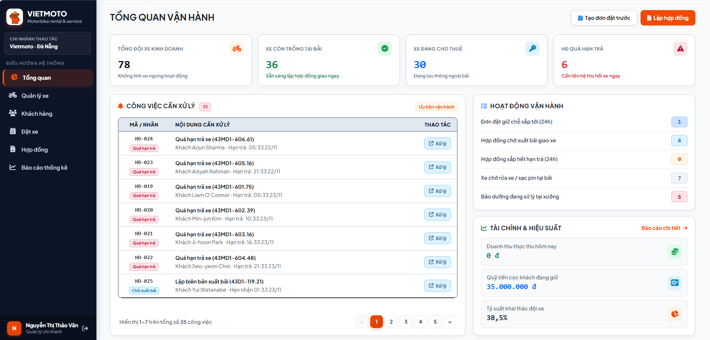
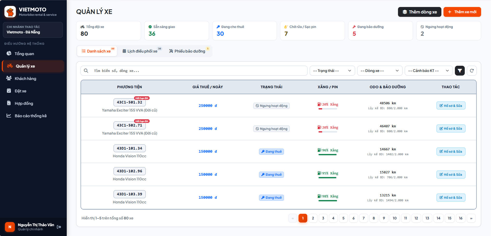
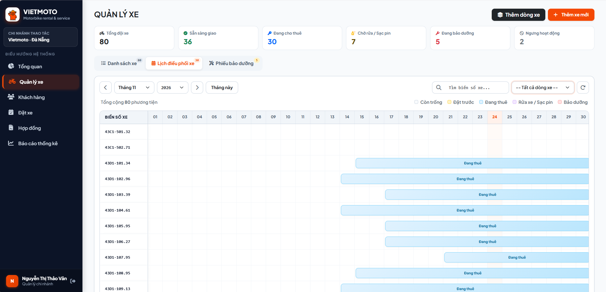
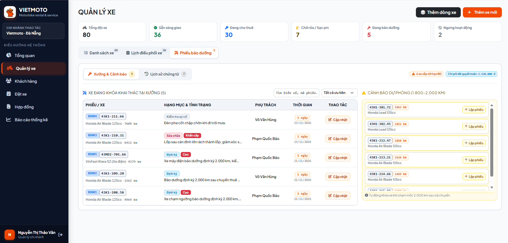
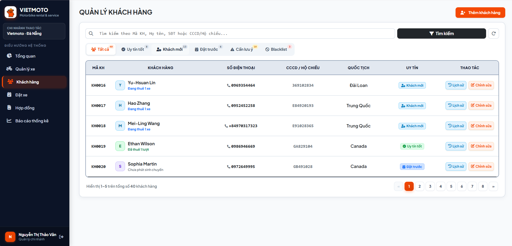
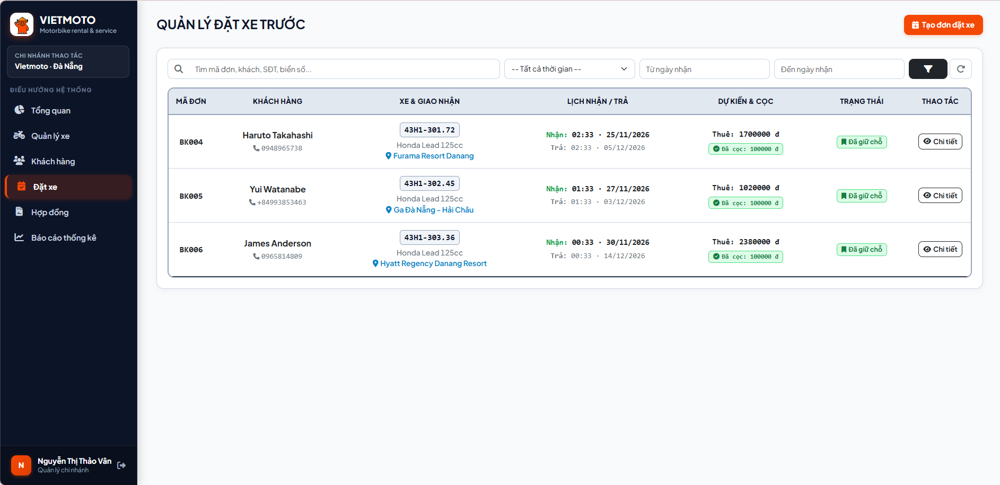
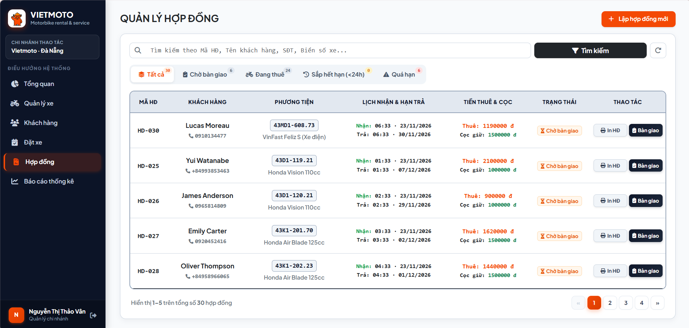
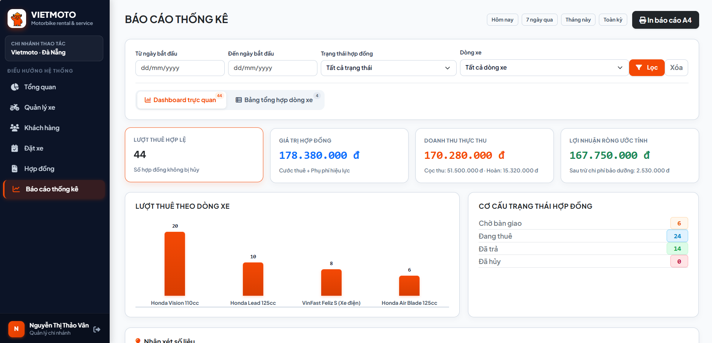

# Vietmoto – Motorcycle Rental Management System

**Hệ thống quản lý đội xe và hợp đồng thuê xe Vietmoto tại Đà Nẵng**

Vietmoto là hệ thống quản lý vận hành cho thuê xe máy được phát triển trên nền tảng Django. Hệ thống hỗ trợ quản lý tập trung đội xe, đặt xe trước, hợp đồng thuê xe, hồ sơ khách hàng, bảo dưỡng phương tiện và hoạt động điều hành kinh doanh.

---

## 1. Giới thiệu dự án (Overview)

Trong hoạt động kinh doanh cho thuê xe máy, việc quản lý tình trạng phương tiện, lịch đặt xe, hợp đồng, khách hàng và bảo dưỡng đòi hỏi sự phối hợp chặt chẽ giữa nhiều bộ phận.

Vietmoto được xây dựng nhằm số hóa và tập trung các nghiệp vụ này trên một nền tảng thống nhất, hỗ trợ nhân viên vận hành, quản lý đội xe và theo dõi hiệu quả kinh doanh.

### Thông tin dự án

| Thuộc tính | Thông tin |
|---|---|
| Tên dự án | Vietmoto |
| Lĩnh vực | Motorcycle Rental Management |
| Loại ứng dụng | Web Application |
| Địa điểm áp dụng | Đà Nẵng, Việt Nam |
| Backend Framework | Django 4.2.8 |
| Ngôn ngữ lập trình | Python |
| Database | SQLite |

## 2. Mục tiêu dự án (Objectives)

- Số hóa quy trình quản lý và điều phối đội xe.
- Hạn chế tình trạng trùng lịch đặt xe và sai sót trong quản lý hợp đồng.
- Tự động hóa các nghiệp vụ như giữ chỗ, nhắc hạn, bảo dưỡng và quyết toán.
- Tập trung hồ sơ khách hàng và lịch sử giao dịch.
- Hỗ trợ phân quyền theo vai trò nhân viên.
- Cung cấp dữ liệu báo cáo phục vụ hoạt động điều hành và ra quyết định.

## 3. Chức năng hệ thống (Features)

Hệ thống bao gồm **6 nhóm chức năng nghiệp vụ** và **5 quy tắc tự động hóa (BRULE-01 – BRULE-05)**.

### 3.1. Tổng quan điều hành (Dashboard)

- Thống kê tức thời cơ cấu trạng thái đội xe:
  - Còn trống.
  - Đang thuê.
  - Chờ rửa xe / Sạc pin.
  - Bảo dưỡng.
  - Ngưng hoạt động.
- Theo dõi tỷ suất khai thác đội xe.
- Hiển thị cảnh báo ưu tiên đầu ca:
  - Hợp đồng sắp hết hạn trong 24 giờ.
  - Hợp đồng quá hạn trả.
  - Xe chạm ngưỡng bảo dưỡng.
  - Phương tiện sắp hết hạn bảo hiểm.

### 3.2. Quản lý và điều phối đội xe (DongXe, PhuongTien)

**Quản lý danh mục dòng xe**
- Phân loại riêng xe xăng và xe máy điện.
- Quản lý đơn giá thuê theo ngày / giờ.
- Quản lý tiền cọc định mức.

**Quản lý phương tiện**
- Biển số, số khung, số máy.
- ODO hiện tại và ODO lũy kế bảo dưỡng.
- Thời hạn bảo hiểm.
- Trạng thái hoạt động của từng phương tiện.

**Lưới lịch điều phối (Fleet Calendar / Gantt View)**
- Hiển thị lịch đặt trước và hợp đồng đang hoạt động theo từng phương tiện.
- Theo dõi tình trạng sử dụng xe trên trục thời gian.
- Hỗ trợ lọc phương tiện còn trống.

**Quy trình hậu cần bãi xe**
- Xe sau khi thu hồi được chuyển sang trạng thái Chờ rửa xe / Sạc pin.
- Chỉ sau khi hoàn tất công việc hậu cần, xe mới được xác nhận Sẵn sàng phục vụ khách tiếp theo.

### 3.3. Quản lý đặt xe trước (DonDatTruoc)

- Tra cứu phương tiện còn trống theo khung ngày / giờ dự kiến.
- Tạo và quản lý đơn giữ chỗ.
- **BRULE-01 – Cơ chế giữ chỗ 2 giờ:** Tự động đếm ngược 2 giờ kể từ giờ hẹn nhận xe. Nếu khách không đến đúng hạn (No-show), đơn được tự động hủy và phương tiện được giải phóng về trạng thái Còn trống.
- **BRULE-02 – Chống trùng lịch:** Ngăn chặn các đơn đặt có khung thời gian giao nhau trên cùng một phương tiện.

### 3.4. Quản lý hợp đồng và biên bản bàn giao QR (HopDongThue, BienBanBanGiao)

**Lập và quản lý hợp đồng**
- Chuyển đổi trực tiếp từ đơn đặt trước thành hợp đồng.
- Hỗ trợ tạo hợp đồng mới cho khách vãng lai.
- Hỗ trợ hình thức đặt cọc:
  - Giữ CCCD gốc đối với khách Việt Nam.
  - Tiền mặt / Chuyển khoản đối với khách quốc tế.
- Xuất bản in hợp đồng song ngữ theo khổ A4.

**Biên bản bàn giao số hóa – BRULE-03**
- Ghi nhận ODO thực tế khi bàn giao.
- Ghi nhận mức xăng / pin.
- Kiểm kê phụ kiện: mũ bảo hiểm, áo mưa, giấy tờ, bộ sạc.
- Lưu ảnh hiện trạng bốn góc xe.
- Tự động tạo mã QR để khách quét và xem biên bản công khai.

**Gia hạn hợp đồng**
- Kiểm tra lịch đặt kế tiếp của phương tiện trước khi duyệt gia hạn.
- Cộng dồn cước thuê phát sinh.

**Thu hồi xe và quyết toán – BRULE-04**
- Tự động tính phụ phí trả xe trễ sau thời gian ân hạn.
- Đối trừ tiền cọc và xác định số tiền cần hoàn trả hoặc thu thêm.
- Lập biên bản thanh lý hợp đồng.

### 3.5. Quản lý hồ sơ khách hàng (KhachHang)

**Quản lý thông tin khách hàng**
- Họ tên, số điện thoại, email.
- Quốc tịch.
- CCCD / Hộ chiếu.
- Giấy phép lái xe (GPLX).
- Lịch sử hợp đồng thuê xe.

**Phân loại tín nhiệm và Blacklist**
- Uy tín tốt.
- Cần lưu ý: từng phát sinh trễ hạn hoặc phụ phí.
- Blacklist: cảnh báo khách hàng vi phạm nghiêm trọng.

Hệ thống hỗ trợ cảnh báo và ngăn chặn việc tạo đơn đặt trước / hợp đồng mới đối với khách hàng thuộc danh sách Blacklist.

### 3.6. Bảo dưỡng định kỳ, phân quyền và báo cáo thống kê

**Bảo dưỡng định kỳ – BRULE-05**
- Cảnh báo vàng khi ODO lũy kế đạt 1.800 km.
- Tự động khóa xe và chuyển sang trạng thái Bảo dưỡng khi ODO lũy kế đạt từ 2.000 km.
- Tạo phiếu bảo dưỡng định kỳ.
- Sau khi kỹ thuật viên hoàn tất phiếu, bộ đếm ODO lũy kế được đặt lại về 0 km.

**Phân quyền người dùng (RBAC)**

Hệ thống phân tách quyền hạn theo ba nhóm vai trò:

| Vai trò | Định hướng nghiệp vụ |
|---|---|
| Quản lý / Admin | Quản lý và giám sát hoạt động hệ thống |
| Nhân viên quầy (Lễ tân) | Tiếp nhận khách hàng, đặt xe và xử lý hợp đồng |
| Kỹ thuật viên bãi xe | Kiểm tra phương tiện, bàn giao, thu hồi và bảo dưỡng |

**Báo cáo tài chính và vận hành**
- Thống kê lượt thuê.
- Giá trị hợp đồng.
- Doanh thu thực thu.
- Đối soát tiền cọc.
- Chi phí bảo dưỡng.
- Lợi nhuận ròng theo ngày, tháng và dòng xe.

## 4. Quy tắc tự động hóa nghiệp vụ (Business Rules)

| Mã quy tắc | Tên quy tắc | Mô tả |
|---|---|---|
| BRULE-01 | Auto Hold / No-show | Giữ chỗ 2 giờ và tự động hủy đơn khi khách không đến đúng hạn |
| BRULE-02 | Booking Conflict Prevention | Kiểm tra trùng lịch đặt xe và lịch đặt tiếp theo trước khi gia hạn |
| BRULE-03 | Digital Handover | Ghi nhận thông tin bàn giao và tạo mã QR biên bản |
| BRULE-04 | Return & Settlement | Tính phụ phí trễ hạn và quyết toán tiền cọc khi thu hồi xe |
| BRULE-05 | Preventive Maintenance | Cảnh báo và khóa xe tự động theo ngưỡng ODO bảo dưỡng |

## 5. Công nghệ sử dụng (Technology Stack)

| Thành phần | Công nghệ |
|---|---|
| Backend | Python |
| Web Framework | Django 4.2.8 |
| Database | SQLite |
| Frontend | HTML, CSS, JavaScript |
| Template Engine | Django Template |
| Development Environment | PyCharm |
| Version Control | Git & GitHub |

## 6. Cấu trúc dự án (Project Structure)

```text
vietmoto-management-system/
│
├── Vietmoto/
│   ├── settings.py
│   ├── urls.py
│   ├── asgi.py
│   └── wsgi.py
│
├── reviews/
│   ├── migrations/
│   ├── static/
│   ├── templates/
│   ├── models.py
│   ├── views.py
│   ├── forms.py
│   ├── permissions.py
│   ├── urls.py
│   └── ...
│
├── templates/
├── manage.py
├── requirements.txt
├── seed_data.py
├── .gitignore
└── README.md
```

## 7. Cài đặt và chạy dự án (Installation & Setup)

### 7.1. Yêu cầu hệ thống

- Python 3.12.
- pip.
- Git.

### 7.2. Clone repository

```bash
git clone https://github.com/BlueCloud242/vietmoto-management-system.git
```

### 7.3. Di chuyển vào thư mục dự án

```bash
cd vietmoto-management-system
```

### 7.4. Tạo môi trường ảo

```bash
python -m venv .venv
```

Kích hoạt trên Windows PowerShell:

```powershell
.\.venv\Scripts\Activate.ps1
```

### 7.5. Cài đặt thư viện

```bash
python -m pip install --upgrade pip
pip install -r requirements.txt
```

### 7.6. Khởi tạo database

```bash
python manage.py migrate
```

### 7.7. Khởi chạy ứng dụng

```bash
python manage.py runserver
```

Truy cập ứng dụng tại:

http://127.0.0.1:8000/

## 8. Bảo mật và dữ liệu (Security & Data)

- Không công khai SECRET_KEY, mật khẩu hoặc API key.
- Không đưa database cá nhân và dữ liệu người dùng lên repository.
- Không đưa thư mục môi trường ảo `.venv/` lên GitHub.
- Sử dụng biến môi trường để cấu hình thông tin nhạy cảm.
- Cấu hình DEBUG, ALLOWED_HOSTS và CSRF_TRUSTED_ORIGINS phù hợp trước khi triển khai production.
- Database mới cần được khởi tạo bằng migrations.

## 9. Giao diện hệ thống (Screenshots)

Các hình ảnh dưới đây minh họa những màn hình nghiệp vụ chính của hệ thống Vietmoto.

9.1. Tổng quan vận hành 



9.2. Quản lý đội xe

Danh sách phương tiện



Lịch điều phối đội xe 



9.3. Quản lý bảo dưỡng



9.4. Quản lý khách hàng



9.5. Quản lý đặt xe trước



9.6. Quản lý hợp đồng



9.7. Báo cáo và thống kê



## 10. Repository

**GitHub:**  
https://github.com/BlueCloud242/vietmoto-management-system

---

*Vietmoto – Motorcycle Fleet and Rental Management System.*
